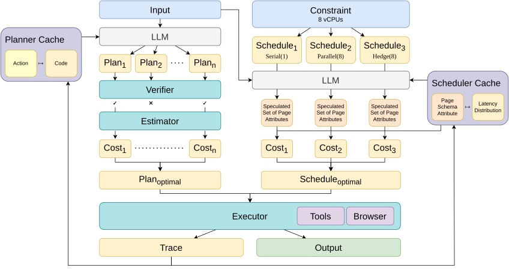

# Agent JIT Compilation

Agent JIT Compilation provides cost-aware planning and task-specific scheduling for web agents.

- **JIT-Planner** composes reusable tools into Python programs, checks their types and state contracts, and selects a valid program by estimated cost.
- **JIT-Scheduler** uses interaction-latency profiles to choose serial, parallel, or hedged execution.

[Documentation](docs/README.md) · [Project page](https://agent-jit-compilation.github.io/) · [Paper (ICML 2026)](https://proceedings.mlr.press/v306/winston26b.html)

[](LICENSE) [](https://github.com/agent-jit-compilation/agent-jit-compilation/actions/workflows/ci.yml)



## Environment setup

Use Python 3.12 or 3.13 and [uv](https://docs.astral.sh/uv/) on Linux or macOS. Run commands from the repository root.

```sh
git clone https://github.com/agent-jit-compilation/agent-jit-compilation.git
cd agent-jit-compilation
uv sync --locked --extra browser
uv run --extra browser patchright install chromium
cp .env.example .env
```

On a fresh Linux host, use `patchright install --with-deps chromium` to install Chromium's system dependencies as well (requires administrator access).

Add your provider key to `.env`. The examples use `OPENAI_API_KEY`; Gemini, Anthropic, and Groq are also supported. See [model configuration](docs/LIVE_EVALUATION.md#choose-models) for execution, prediction, and evaluation settings.

Dashdish, Gomail, and Omnizon are hosted clones from the REAL benchmark and need no local setup. The WebArena GitLab and Reddit tasks need an x86_64 Linux host with local Docker and the populated application images; follow [WebArena setup](docs/WEBARENA.md).

For static plan checks and recorded-result analysis, only `uv sync --locked` is needed.

## Run JIT-Planner

Tool libraries for the five benchmark applications are included in `data/registries/`.

```sh
mkdir -p runs
cp configs/planner-real-smoke.yaml runs/planner.yaml
uv run --extra browser --env-file .env agent-jit evaluate \
  --config runs/planner.yaml --output runs/planner-run
uv run agent-jit validate-results runs/planner-run/results.jsonl
```

The example task asks for the first three restaurants on the Dashdish homepage. The planner generates two valid candidates (up to eight attempts), selects by estimated cost, executes the program, and evaluates the result. Trial directories contain `candidates.json`, `selected.py`, `answer.txt`, and `worker.log` as each stage completes.

Edit `tasks`, `model`, `candidates`, and `trials` in the configuration. See [the planner guide](docs/PLANNER.md) for tool contracts, standalone generation, and cost-based selection.

You can also check and rank the supplied example programs without a browser or API key:

```sh
uv run agent-jit planner rank \
  examples/plans/invalid.py examples/plans/inference.py examples/plans/valid.py \
  --registry data/registries/dashdish.json --state '{"page_type":"home"}'
```

## Run JIT-Scheduler

Page schemas and latency profiles for Dashdish, Gomail, and Omnizon are included in `data/scheduler/`.

```sh
cp configs/scheduler-real-smoke.yaml runs/scheduler.yaml
uv run --extra browser --env-file .env agent-jit evaluate \
  --config runs/scheduler.yaml --output runs/scheduler-run
uv run agent-jit validate-results runs/scheduler-run/results.jsonl
```

The example predicts element usage, estimates strategy costs, and executes its selected schedule with a four-worker budget. Set `strategy` to `jit`, `serial`, `parallel`, or `hedge`. See [the scheduler guide](docs/SCHEDULER.md) for usage prediction, latency profiles, and worker settings.

As in the paper, the two components run separately: the planner executes generated programs, and the scheduler coordinates browser-agent workers.

Both example configurations run one task once, with a $1 API spending limit. The limits (`budget_usd` and `max_requests`) are cumulative across all runs that share a `ledger` file, so raising a limit does not clear earlier charges. Use a new output directory for each run. [Live execution](docs/LIVE_EVALUATION.md) describes all settings and result fields.

## Benchmark tasks

The paper uses **37 tasks across five applications**. JIT-Scheduler uses the 27-task REAL subset.

| Application | JIT-Planner | JIT-Scheduler |
| --- | ---: | ---: |
| Dashdish | 9 | 9 |
| Gomail | 9 | 9 |
| Omnizon | 9 | 9 |
| GitLab (WebArena) | 5 | — |
| Reddit (WebArena) | 5 | — |
| **Total** | **37** | **27** |

```sh
uv run agent-jit tasks --component planner
uv run agent-jit tasks --component scheduler
uv run agent-jit tasks gomail-custom-8
```

[Task descriptions](docs/TASKS.md) lists instructions, IDs, starting URLs, and oracle schedules. The machine-readable catalog is [benchmarks/tasks.json](benchmarks/tasks.json). Select tasks by editing the configuration's `tasks` list.

## Add tasks and applications

Start with [adding a task and verifier](docs/ADDING_TASKS.md). Reuse the supplied tools and profiles when they cover the new task, or prepare new inputs:

| Component | Preparation | Guide |
| --- | --- | --- |
| Planner | Capture application context → author or synthesize tools → check contracts → generate and execute plans | [Tool preparation](docs/PLANNER.md#prepare-a-tool-library) |
| Scheduler | Capture pages → extract schemas → collect and label traces → fit latency profiles → predict and execute schedules | [Schema and profile preparation](docs/SCHEDULER.md#prepare-page-schemas-and-latency-profiles) |

Tools can be written by hand or with Codex, Claude Code, or another coding agent. The guides explain intermediate files, prompt customization, and model selection.

## Reproduce the paper results

The included measurements support offline reproduction without model calls:

```sh
uv run agent-jit analyze-planner --output runs/recorded
uv run agent-jit analyze --figure all --output runs/recorded
```

These produce Table 1 (Markdown and CSV) and Figures 5–10 (PNG and PDF), each with its measurements in JSON. See [result commands](docs/PAPER_TO_COMMANDS.md) and [aggregation details](docs/RECORDED_RESULTS.md).

## Repository layout

| Directory | Contents |
| --- | --- |
| `agent_jit/` | CLI, model clients, task execution, and analysis |
| `blastai/` | Planner, tool execution, and browser-worker runtime |
| `blast_scheduler/` | Schemas, trace labeling, latency profiles, and schedule selection |
| `configs/`, `examples/` | Run configurations and example programs |
| `benchmarks/`, `experiments/` | Task catalog, evaluators, and experiment implementations |
| `data/` | Tool libraries, scheduler profiles, and recorded measurements |
| `docs/` | Usage, extension, and reproduction guides |
| `tests/` | Automated tests |
| `scripts/` | Page-capture utility |

For development and test commands, see [the documentation index](docs/README.md#development).

## Citation

If you use our work, please cite:

```bibtex
@inproceedings{winston2026agentjit,
  title     = {Agent {JIT} Compilation for Latency-Optimizing Web Agent Planning and Scheduling},
  author    = {Winston, Caleb and Wang, Ron Yifeng and Mirhoseini, Azalia and Kozyrakis, Christos},
  booktitle = {Proceedings of the 43rd International Conference on Machine Learning},
  pages     = {135161--135186},
  year      = {2026},
  volume    = {306},
  series    = {Proceedings of Machine Learning Research},
  publisher = {PMLR},
  url       = {https://proceedings.mlr.press/v306/winston26b.html}
}
```
